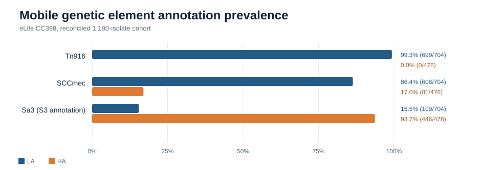
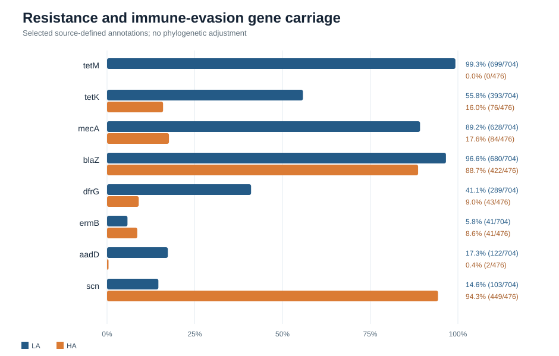

# CC398 Genomic Features and Host Association

**Hafiza Muntaha Fatima**

Independent computational reanalysis of published isolate-level annotations of *Staphylococcus aureus* CC398.

**Original article:** Matuszewska M, Murray GGR et al. (2022). *Stable antibiotic resistance and rapid human adaptation in livestock-associated MRSA*. *eLife* **11**:e74819. [DOI: 10.7554/eLife.74819](https://doi.org/10.7554/eLife.74819).

## Analysis notebook

[**Open the source-audited Jupyter notebook**](notebooks/CC398_Host_Associated_Genomic_Variation_Source_Audited.ipynb)

[**Launch this notebook in Google Colab**](https://colab.research.google.com/github/hafizamuntaha-fatima/cc398-host-adaptation-audit/blob/main/notebooks/CC398_Host_Associated_Genomic_Variation_Source_Audited.ipynb)

The notebook retrieves three official supplementary workbooks, performs isolate-ID reconciliation, computes annotation frequencies and unadjusted statistical tests, and writes CSV results and figures. It requires an internet connection for its initial data retrieval, unless the workbooks are manually uploaded in Colab. Source file locations and hashes are documented in [the manifest](results/input_manifest.csv).

## Figures

The figures use consistent dark-blue livestock-associated (LA) and orange human-associated (HA) colours. Percentages are calculated from the reconciled 1,180-isolate annotation cohort. Raw numerator and denominator values appear in [mobile-element](results/mge_prevalence.csv) and [gene](results/gene_prevalence.csv) summaries.

## Reproducibility and validated outputs

| Material | Description |
|---|---|
| [Notebook](notebooks/CC398_Host_Associated_Genomic_Variation_Source_Audited.ipynb) | Complete Google Colab analysis |
| [Methods](docs/METHODS.md) | Detailed methods and interpretation boundaries |
| [Source manifest](results/input_manifest.csv) | Official source URLs, hashes and source sizes |
| [Cohort audit](results/cohort_audit.csv) | Three source tables, 1,180 IDs successfully matched |
| [ID correction log](results/isolate_id_reconciliation.csv) | Two zero-padding mismatches resolved |
| [Mobile elements](results/mge_prevalence.csv) | Tn916, SCCmec and the File 3 \`Sa3\` annotation |
| [Genes](results/gene_prevalence.csv) | Eight selected resistance and immune-evasion gene annotations |
| [Unadjusted Fisher tests](results/gene_fisher_unadjusted.csv) | Two-sided pooled isolate-level descriptive tests |
| [Annotation concordance](results/source_gene_concordance.csv) | Cross-file overlap and five \`mecA\` disagreements |
| [Individual discordant calls](results/source_gene_disagreements.csv) | Isolate-level details |
| [Sa3 interpretation](results/sa3_annotation_vs_article.csv) | Field annotation vs. the manuscript's prophage count |
| [Accession gaps](results/accession_gaps.csv) | Six missing isolate-specific accession fields |
| [Historical comparison](results/earlier_summary_comparison.csv) | 22 checks against earlier 1,178-isolate results |
| [Dependencies](requirements.txt) | Python package requirements |

**Study population.** The reconciled source annotations comprise 1,180 isolates, including 704 LA and 476 HA clade assignments. Two strain names have inconsistent leading zeros across tables. The earlier 1,178-isolate analysis is retained separately as a historical comparison and should not be mistaken for the corrected full-cohort figures.

**Important interpretation boundaries.** The annotation \`Sa3=1\` occurs in 109/704 LA isolates, while the paper reports 68/704 carrying a φSa3 prophage. These measures should not be treated as identical until the underlying definition is established. Five \`mecA\` calls differ between Supplementary Files 3 and 7; the figure uses the declared File 3 source. The pooled Fisher p-values are **not phylogeny-adjusted** and do not independently establish host adaptation. The original publication's 70 independently sampled phylogenetic comparisons and McNemar method are credited, not claimed as reproduced here.

This repository contains **source-derived summary results**, not the original proprietary dataset or any unperformed experimental work. The original supplementary files remain available from the cited publisher. The notebook regenerates the full accession manifest and all derived exports when run.
